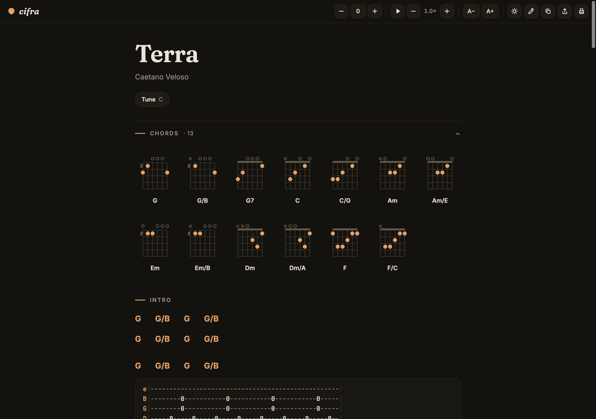

# Cifra — beautiful guitar tabs in the browser

A single-file mini site. Paste any guitar tab — plain text, or a raw copy from
Ultimate Guitar (spans, classes and all) — and it renders as a clean, playable
chord chart: chords aligned over lyrics, chord diagrams, tablature blocks,
transposition, auto-scroll, print, and share links. No build step, no backend,
nothing leaves the browser.



## Run it locally

```bash
python3 -m http.server 8765
# open http://localhost:8765
```

(Any static file server works. Opening `index.html` directly also works.)

## Host it

Everything lives in `index.html`, so any static host will do:

- **GitHub Pages** — push `index.html` to a repo, enable Pages on the branch.
- **Netlify** — drag the folder onto <https://app.netlify.com/drop>.
- **Vercel / Cloudflare Pages / S3** — deploy as a plain static site.

## What it does with a pasted tab

| Input | Output |
| --- | --- |
| `Song title:` / `Composition:` / `Tune:` lines | Title, artist, meta chips |
| `[Verse 1]`, `[Chorus]`, … | Section headers |
| Chord lines above lyrics (`G/B    G` …) | Chords anchored over the exact syllable |
| `e|---0-2-…` blocks | Monospace tab cards, fret numbers highlighted |
| Chord-only lines | Instrumental rows |
| Any `A–G` chord (slash chords, 7ths, sus, dim…) | Voicing diagram — canonical shapes for open chords, computed fretboards for everything else |

Extras: transpose ±11 (also `[` / `]` keys), auto-scroll (Space, adjustable
speed), text size, light/dark, copy-as-text, print stylesheet, and a share
link that encodes the whole tab in the URL. The current tab is remembered in
`localStorage`.

## Notes

- Chord diagrams use a small music-theory engine: chord tones are resolved,
  then the fretboard is searched for a playable voicing (right bass note for
  slash chords, all chord tones present, minimal fretting). Common open
  shapes come from a built-in dictionary.
- Google Fonts (Fraunces / Inter / JetBrains Mono) load from a CDN with
  system fallbacks — the site works fully offline without them.
